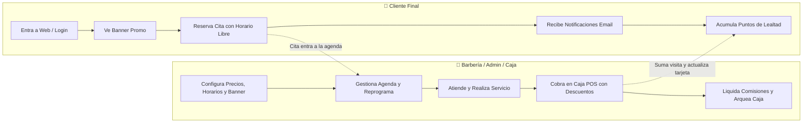
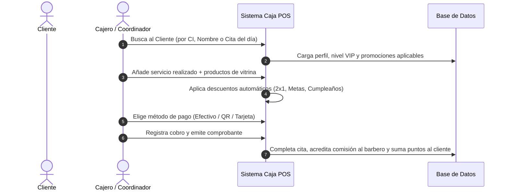

# 💈 Manual Integral de BarberSite: Guía para Administradores y Clientes Finales

Este documento es el manual oficial y operativo de **BarberSite / Barber Pro**. Explica en detalle cómo funciona el sistema desde dos perspectivas:
1. **La Barbería (Dueño, Administrador y Personal de Caja/Coordinación)**: Cómo se administra, configura, gestiona la agenda, opera la Caja POS y supervisa el negocio.
2. **El Cliente Final (Usuario del Servicio)**: Cómo reserva citas, cómo interpreta los horarios libres y ocupados, cómo recibe notificaciones, cómo utiliza su tarjeta de lealtad y cómo aprovecha las promociones.

---

## 📌 Índice General

1. [Visión General del Ecosistema](#1-visión-general-del-ecosistema)
2. [PARTE 1: Guía para el Cliente Final (Experiencia del Usuario)](#2-parte-1-guía-para-el-cliente-final-experiencia-del-usuario)
   - [2.1. Registro, Acceso y Banner Promocional Splash](#21-registro-acceso-y-banner-promocional-splash)
   - [2.2. Cómo Agendar una Cita (Paso a Paso en `/reservar`)](#22-cómo-agendar-una-cita-paso-a-paso-en-reservar)
   - [2.3. Horarios Libres vs Horarios Ocupados (Semáforo de Disponibilidad)](#23-horarios-libres-vs-horarios-ocupados-semáforo-de-disponibilidad)
   - [2.4. Promociones Especiales y Registro de Acompañante 2x1](#24-promociones-especiales-y-registro-de-acompañante-2x1)
   - [2.5. Métodos de Pago y Confirmación por QR](#25-métodos-de-pago-y-confirmación-por-qr)
   - [2.6. Notificaciones que Recibe el Cliente](#26-notificaciones-que-recibe-el-cliente)
   - [2.7. Panel Personal del Cliente (`/cliente`) y Fidelización](#27-panel-personal-del-cliente-cliente-y-fidelización)
3. [PARTE 2: Guía para el Administrador y Coordinador](#3-parte-2-guía-para-el-administrador-y-coordinador)
   - [3.1. Panel de Configuración General (`/admin/configuracion`)](#31-panel-de-configuración-general-adminconfiguracion)
   - [3.2. Banner Promocional del Mes: Cómo Cargar, Activar y Editar](#32-banner-promocional-del-mes-cómo-cargar-activar-y-editar)
   - [3.3. Gestión de Servicios y Precios (`/admin/servicios`)](#33-gestión-de-servicios-y-precios-adminservicios)
   - [3.4. Gestión de Barberos y Horarios Semanales (`/admin/equipo` y `/admin/horarios`)](#34-gestión-de-barberos-y-horarios-semanales-adminequipo-y-adminhorarios)
   - [3.5. Agenda Interactiva y Reprogramaciones (`/agenda`)](#35-agenda-interactiva-y-reprogramaciones-agenda)
   - [3.6. Sistema de Lealtad, Metas y Beneficios de Cumpleaños (`/admin/lealtad`)](#36-sistema-de-lealtad-metas-y-beneficios-de-cumpleaños-adminlealtad)
4. [PARTE 3: Caja POS (Punto de Venta Presencial en Mostrador)](#4-parte-3-caja-pos-punto-de-venta-presencial-en-mostrador)
   - [4.1. Propósito y Acceso al Módulo POS (`/admin/caja`)](#41-propósito-y-acceso-al-módulo-pos-admincaja)
   - [4.2. Flujo Completo de Cobro en Mostrador](#42-flujo-completo-de-cobro-en-mostrador)
   - [4.3. Impactos Automáticos del Cobro en Todo el Negocio](#43-impactos-automáticos-del-cobro-en-todo-el-negocio)
   - [4.4. Cierre y Arqueo Diario de Caja (`/coordinador/arqueo`)](#44-cierre-y-arqueo-diario-de-caja-coordinadorarqueo)
5. [PARTE 4: Matriz de Sincronización: Admin Configura ➔ Cliente Experimenta](#5-parte-4-matriz-de-sincronización-admin-configura--cliente-experimenta)
6. [PARTE 5: Preguntas Frecuentes y Solución de Problemas (Troubleshooting)](#6-parte-5-preguntas-frecuentes-y-solución-de-problemas-troubleshooting)

---

## 1. Visión General del Ecosistema

BarberSite es una plataforma integral de gestión y experiencia para barberías. Conecta en tiempo real la página web comercial, el motor de reservas en línea, el sistema de fidelización de clientes, la agenda de los barberos y el punto de cobro (POS) con contabilidad integrada.

---

## 2. PARTE 1: Guía para el Cliente Final (Experiencia del Usuario)

El cliente final es la persona que utiliza la plataforma para agendar sus cortes de cabello, barba o tratamientos, consultar sus turnos y beneficiarse del programa de lealtad.

### 2.1. Registro, Acceso y Banner Promocional Splash

1. **Acceso desde cualquier dispositivo**: El cliente puede ingresar desde su teléfono móvil o computadora a través del enlace web del negocio.
2. **Inicio de Sesión / Registro**: Puede crear una cuenta rápida con su nombre, correo, teléfono y contraseña o carnet de identidad.
3. **Banner Promocional del Mes (Splash Popup)**:
   - Inmediatamente al iniciar sesión en su panel, si la barbería tiene una promoción destacada activa (ejemplo: "Cortes 2x1 por aniversario", "Promo Barba + Mascarilla"), se despliega automáticamente una ventana flotante con el afiche o imagen promocional, título descriptivo y un botón para aprovechar la promoción.
   - El cliente puede cerrar la ventana haciendo clic en el botón con la cruz **"✕"** o en el botón "Cerrar" y continuar normalmente a su panel. El sistema recuerda su elección en la sesión para no abrumarlo repetidamente.
4. **Navegación Móvil Mejorada**:
   - En la esquina superior y en la barra de menú móvil, el cliente siempre tiene a mano el botón para ver sus citas y turnos activos, así como el botón visible para **"Cerrar Sesión"** de forma segura.

---

### 2.2. Cómo Agendar una Cita (Paso a Paso en `/reservar`)

El cliente puede reservar en menos de 2 minutos mediante un asistente interactivo ("Wizard"):

1. **Paso 1: Selección del Servicio o Paquete**:
   - Selecciona los servicios que desea (ej. Corte Clásico, Degradado, Barba VIP, etc.).
   - Se muestra con claridad el precio en moneda local (Bs) y la duración estimada en minutos.
2. **Paso 2: Selección del Barbero**:
   - Puede seleccionar a su barbero de preferencia viendo su fotografía, o elegir la opción "Cualquiera disponible" para mayor flexibilidad de horarios.
3. **Paso 3: Selección de Fecha y Turno**:
   - Elige el día en el calendario interactivo.
   - El sistema calcula los turnos disponibles cruzando la jornada laboral del barbero y los cortes que ya tiene agendados.
4. **Paso 4: Datos y Confirmación**:
   - Ingresa o verifica sus datos de contacto.
   - Selecciona el método de pago o anticipo.
5. **Paso 5: Resumen y Comprobante Digital**:
   - Se genera el pase de la cita con fecha, hora, código de confirmación y recordatorio de tolerancia.

---

### 2.3. Horarios Libres vs Horarios Ocupados (Semáforo de Disponibilidad)

Para evitar malentendidos y garantizar una reserva transparente, el sistema presenta un visualizador claro de horarios:

- 🟢 **Horarios Libres (Disponibles)**: Se muestran en color verde o con bordes resaltados interactivos. Al tocarlos, se seleccionan para la cita.
- 🔴 **Horarios Ocupados (No disponibles)**: Se muestran claramente en color **rojo** con la leyenda *"Ocupado"* o *"No disponible"*. Están completamente deshabilitados para hacer clic, evitando cruces de citas o reservas dobles.

> [!NOTE]
> Los horarios ocupados reflejan en tiempo real tanto citas reservadas por otros clientes en la web como citas ingresadas manualmente por el personal en recepción.

---

### 2.4. Promociones Especiales y Registro de Acompañante 2x1

Si el cliente selecciona una promoción especial del tipo **2x1 en Cortes**:
1. El sistema le solicitará el nombre de su acompañante.
2. Ambos clientes quedan vinculados a la promoción.
3. El acompañante recibe un aviso para estar informado de su turno.
4. Al momento del cobro en la barbería, el sistema aplicará automáticamente el costo de un solo servicio para ambos cortes.

---

### 2.5. Métodos de Pago y Confirmación por QR

Para confirmar su cita, la barbería puede requerir un anticipo de garantía (por ejemplo, Bs 20):
1. **Escaneo de Código QR**: En la pantalla de pago se muestra el Código QR oficial de cobro bancario de la barbería.
2. **Pago desde la App Bancaria**: El cliente abre su aplicación de banco preferida, escanea el QR y transfiere el monto indicado.
3. **Subida de Comprobante**: El cliente toma una captura de pantalla del comprobante bancario y la adjunta en el botón "Subir Comprobante".
4. **Validación**: La recepción valida el comprobante y la cita pasa a estado *"Confirmada"*.
5. **Tolerancia y Garantía**: Con su anticipo registrado, el cliente cuenta con una tolerancia de 5 minutos al llegar a la barbería y su cupo queda 100% asegurado.

---

### 2.6. Notificaciones que Recibe el Cliente

El sistema mantiene al cliente informado en cada etapa mediante correos electrónicos automáticos y alertas en el panel:

| Tipo de Notificación | Momento de Envío | Contenido |
|---|---|---|
| **Confirmación de Reserva** | Inmediatamente al agendar | Fecha, hora, barbero, servicio, dirección y pase digital. |
| **Recordatorio Previo** | Horas antes de la cita | Aviso de proximidad para evitar olvidos o retrasos. |
| **Propuesta de Reprogramación** | Si la barbería necesita mover la cita | Detalle del nuevo horario propuesto y botones directos para **Aceptar** o **Rechazar**. |
| **Aprobación de Pago QR** | Cuando recepción revisa el pago | Confirmación de que el anticipo fue validado con éxito. |
| **Felicitación de Cumpleaños** | En la semana del cumpleaños | Saludo personalizado y cupón o corte gratis aplicable. |
| **Reseña y Calificación** | Al finalizar el servicio | Invitación a calificar el corte (estrellas y comentarios). |

#### ¿Cómo responder a una Reprogramación?
Si la barbería por alguna eventualidad necesita cambiar el horario de la cita:
1. El cliente recibe un correo y ve un aviso destacado en su panel de cliente.
2. Se le presentan dos botones directos:
   - **✅ Aceptar Nueva Fecha**: Al hacer clic, la cita se reprograma automáticamente al nuevo horario sin trámites adicionales.
   - **❌ Rechazar**: Si el cliente no puede en ese nuevo horario, la barbería es notificada de inmediato para ofrecerle otra alternativa o coordinar por WhatsApp.

---

### 2.7. Panel Personal del Cliente (`/cliente`) y Fidelización

Al ingresar a `/cliente`, el usuario dispone de un área privada diseñada para premiar su lealtad:

1. **Tarjeta Digital de Lealtad (Nivel VIP)**:
   - Niveles disponibles: **Bronce ➔ Plata ➔ Oro ➔ Platino ➔ Diamante**.
   - Cada nivel ofrece ventajas exclusivas, descuentos automáticos y trato preferencial.
2. **Barra de Progreso de Cortes (Metas)**:
   - Muestra cuántas visitas lleva acumuladas y cuántos cortes le faltan para su siguiente recompensa (por ejemplo: *"Te faltan 2 cortes para tu corte gratis"*).
3. **Club de Cumpleaños**:
   - El cliente puede registrar su fecha de nacimiento y subir una foto de su carnet de identidad para verificarla. Al estar verificado, recibe su beneficio de cumpleaños configurado por la barbería.
4. **Sistema de Recomendación (Gana Invitando a tus Amigos)**:
   - Cada cliente dispone de un **Código de Referido** y un botón para compartir por WhatsApp.
   - Cuando un amigo se registra y se realiza su primer corte, ambos ganan saldo de descuento en la barbería.
5. **Historial de Citas y Pase Digital**:
   - Puede consultar el historial completo de todos los cortes realizados, qué barbero lo atendió y descargar o ver el pase de su próxima cita.

---

## 3. PARTE 2: Guía para el Administrador y Coordinador

El Administrador y el Coordinador gestionan todo el negocio desde el panel central, controlando desde la presencia de marca hasta las comisiones y arqueos de caja.

### 3.1. Panel de Configuración General (`/admin/configuracion`)

Desde esta sección se configuran los parámetros visuales y operativos del negocio:

- **Datos de la Barbería**: Nombre comercial, número de teléfono, enlace de WhatsApp directo, dirección física y enlaces a redes sociales (Instagram, Facebook, TikTok).
- **Código QR Oficial de Pagos**:
  - Subida de la imagen del QR bancario institucional.
  - Este QR es el que se le muestra automáticamente a todos los clientes en la pantalla de pago de reservas `/reservar` y en el POS cuando eligen pago por QR.
- **Portada Principal (Hero)**: Título llamativo, subtítulo y fotografía principal de fondo de la web pública.
- **Sección "Acerca de Nosotros"**: Historia de la barbería, valores y fotografía del local.
- **Bono de Referidos**: Configuración del monto en Bs que se regala al cliente que recomienda y al nuevo cliente.

---

### 3.2. Banner Promocional del Mes: Cómo Cargar, Activar y Editar

Esta función permite comunicar campañas especiales a todos los clientes que inician sesión:

1. Ingrese a **Administración ➔ Configuración** (`/admin/configuracion`).
2. Desplácese hasta la tarjeta **📢 Banner Promocional del Mes (Splash)**.
3. **Interruptor de Activación**:
   - Encienda o apague el switch *"Activar banner promocional al iniciar sesión"*. Si está apagado, los clientes no verán ninguna ventana emergente.
4. **Subir la Imagen**:
   - Haga clic en el cargador de imágenes y seleccione el afiche, volante o banner promocional (formato JPG, PNG o WebP).
5. **Textos y Enlace**:
   - **Título**: Ejemplo: *"¡Cortes 2x1 este mes de Aniversario!"* o *"Combo Barba + Limpieza Facial"*.
   - **Descripción**: Breve texto explicando las condiciones o vigencia de la promo.
   - **Enlace de Destino (Opcional)**: URL a la que se redirige al cliente si hace clic en el botón (por ejemplo `/reservar`).
6. **Previsualización en Vivo**:
   - A la derecha verá exactamente cómo lucirá la ventana emergente que verán los clientes en sus pantallas.
7. **Guardar**: Presione el botón *"Guardar Banner Promocional"*. El cambio entra en vigor inmediatamente.

---

### 3.3. Gestión de Servicios y Precios (`/admin/servicios`)

- **Catálogo de Servicios**: Crear, editar o eliminar servicios (ej. Corte Ejecutivo, Fade, Barboterapia, Tinte).
- **Configuración de Duración**: Definir cuánto tiempo dura el servicio (ej. 30 min, 45 min, 60 min). Esto es fundamental porque el motor de reservas calcula la disponibilidad de los horarios basándose en esta duración.
- **Precios y Categorías**: Definir precio base y organizar los servicios por categorías (Populares, Cortes, Barba, Combos, Tratamientos).

---

### 3.4. Gestión de Barberos y Horarios Semanales (`/admin/equipo` y `/admin/horarios`)

1. **Ficha del Barbero (`/admin/equipo`)**:
   - Foto de perfil, nombre, teléfono, correo y contraseña de acceso.
   - Porcentaje de comisión individual acordado (ej. 50% en cortes, 10% en productos).
   - Código QR personal del barbero (opcional, para propinas o cobros directos).
2. **Horarios de Trabajo (`/admin/horarios`)**:
   - Asignar los días laborales de cada barbero (ej. Lunes a Sábado).
   - Hora de inicio de jornada y hora de fin de jornada.
   - Intervalos de descanso o almuerzo (ej. 13:00 a 14:00).
   - Bloqueos de vacaciones o permisos especiales.
3. **Efecto Inmediato en la Web**:
   - Si un barbero no trabaja los domingos o tiene descanso de 13:00 a 14:00, esos bloques de tiempo jamás aparecerán disponibles para los clientes en `/reservar`.

---

### 3.5. Agenda Interactiva y Reprogramaciones (`/agenda`)

La pantalla de `/agenda` es el corazón visual de la barbería:

- **Vista Multicolumna**: Muestra en columnas paralelas las agendas de todos los barberos del día.
- **Colores por Estado**:
  - 🟡 *Pendiente*
  - 🔵 *Confirmada*
  - 🟣 *En Proceso* (cliente en silla)
  - 🟢 *Completada*
  - 🔴 *Cancelada*
- **Cómo Reprogramar una Cita desde la Barbería**:
  1. Haga clic sobre la cita en el calendario.
  2. En el modal de detalle, haga clic en el botón **"📅 Reprogramar"**.
  3. Seleccione la nueva fecha y hora (o cambie de barbero si es necesario).
  4. Presione *"Confirmar Reprogramación"*.
  5. **Acción Automática del Sistema**: El sistema cambia el horario y dispara un correo electrónico inmediato al cliente con los detalles de la nueva hora y botones para que confirme su conformidad.

---

### 3.6. Sistema de Lealtad, Metas y Beneficios de Cumpleaños (`/admin/lealtad`)

- **Promociones Activas**:
  - Crear ofertas del tipo 2x1, descuentos en porcentaje (ej. 20% OFF los martes) o descuentos en montos fijos.
  - Definir qué días de la semana aplican y si requieren un nivel de cliente específico.
- **Metas del Club de Lealtad**:
  - Configurar las recompensas por visitas recurrentes (ej. Visita 5: 30% descuento; Visita 10: Corte gratis).
- **Parámetros de Cumpleaños**:
  - Definir qué beneficio se otorga al cliente cumpleañero (corte gratis, servicio de barba de regalo o porcentaje de descuento) y cuántos días antes o después de su fecha puede reclamarlo.

---

## 4. PARTE 3: Caja POS (Punto de Venta Presencial en Mostrador)

El módulo de Caja POS (`/admin/caja` o `/coordinador/ventas`) está diseñado para liquidar los servicios y productos con máxima rapidez en el mostrador una vez terminado el corte.

### 4.1. Propósito y Acceso al Módulo POS (`/admin/caja`)

- Diseñado para operar con pantallas táctiles, tabletas o computadoras de escritorio.
- Elimina completamente los cuadernos manuales y calcula automáticamente el dinero ingresado, el vuelto y las comisiones del personal.

---

### 4.2. Flujo Completo de Cobro en Mostrador

#### Paso 1: Identificación del Cliente
- **Buscador Rápido**: Ingrese el Carnet de Identidad (CI), Nombre o Teléfono del cliente.
- **Detección Automática de Cita**: Si el cliente tenía una reserva para el día de hoy, el sistema muestra la cita pendiente con un botón *"Cargar Cita"*.
- **Registro de Cliente Nuevo**: Si es una persona que entra por primera vez de la calle, puede presionar *"Nuevo Cliente"* y registrar su nombre y teléfono en 5 segundos para que empiece a acumular puntos desde su primer corte.
- **Cliente Casual**: Opción de cobro sin registro para clientes de paso.

#### Paso 2: Selección de Servicios y Barbero
- Si cargó una cita agendada, el servicio y el barbero asignado se rellenan automáticamente.
- Si el cliente solicitó un servicio adicional en el momento (por ejemplo: corte + perfilado de barba), puede agregar servicios complementarios con un solo clic.

#### Paso 3: Venta de Productos de Vitrina (Up-selling)
- Si el cliente compra cera para peinar, pomada, aceite de barba o minoxidil:
  - Busque el producto en el catálogo táctil de la derecha.
  - Seleccione la cantidad.
  - El sistema verifica que haya stock disponible en almacén y lo descuenta al finalizar.

#### Paso 4: Aplicación de Promociones y Descuentos
En la parte inferior de la comanda, el cajero puede aplicar los beneficios que correspondan:
- **Promo 2x1**: Se marca la promoción y el sistema bonifica el segundo corte correspondiente.
- **Bono de Referido**: Si el cliente recomendó a un amigo, aparece su saldo a favor para descontarlo del total.
- **Corte Gratis por Meta de Lealtad**: Si el cliente alcanzó sus visitas requeridas, el sistema avisa con una insignia dorada y descuenta el 100% del servicio.
- **Descuento de Cumpleaños**: Si la fecha coincide con la semana del cumpleaños y su carnet está verificado, se aplica el regalo configurado.

#### Paso 5: Selección del Método de Pago y Arqueo
El cajero selecciona cómo abona el cliente:
1. **Efectivo**:
   - El cajero introduce el monto recibido (ej. entrega billete de 100 Bs para una cuenta de 60 Bs).
   - El sistema calcula y muestra en números grandes el **Cambio / Vuelto a entregar** (40 Bs).
2. **Código QR Simple / Transferencia**:
   - La pantalla muestra el Código QR institucional de la barbería para que el cliente lo escanee en el momento con su móvil.
   - El cajero verifica el comprobante en la app bancaria y marca *"Pago Verificado"*.
3. **Tarjeta de Débito / Crédito**:
   - Registro de cobro efectuado a través de terminal bancario físico (POS externo).
4. **Pago Mixto**:
   - Permite abonar una parte en efectivo y otra parte mediante transferencia QR.

#### Paso 6: Confirmación e Impresión de Comprobante
- Al presionar **"Confirmar y Cobrar"**, la venta queda registrada.
- Se genera un comprobante o ticket de venta que puede ser impreso en impresora térmica de recibos o consultado digitalmente.

---

### 4.3. Impactos Automáticos del Cobro en Todo el Negocio

En el instante exacto en que se presiona *"Confirmar Cobro"*, el sistema ejecuta en cadena las siguientes acciones sin intervención manual:

1. **En la Cita**: Pasa de estado *"Pendiente/En Proceso"* a **"Completada"**.
2. **En el Perfil del Cliente**:
   - Se suma **+1 visita** a su contador histórico.
   - Se incrementa el monto acumulado gastado en su cuenta.
   - Si alcanzó las visitas de su siguiente nivel (ej. pasó de Plata a Oro), su tarjeta se actualiza automáticamente.
3. **En el Barbero**:
   - Se registra su porcentaje de comisión en la tabla de nómina (`/admin/comisiones`).
   - El barbero puede ver en su propio panel cuánto dinero ganó por ese corte.
4. **En el Inventario**:
   - Si se vendió un producto físico, se descuenta 1 unidad del inventario real.
5. **En la Contabilidad**:
   - El dinero ingresa al registro diario de transacciones, clasificando claramente qué monto ingresó a la **Caja Física en Efectivo** y qué monto ingresó a la **Cuenta Bancaria (QR/Tarjeta)**.

---

### 4.4. Cierre y Arqueo Diario de Caja (`/coordinador/arqueo`)

Al concluir el día de trabajo:
1. El encargado entra a **Coordinación ➔ Arqueo de Caja**.
2. El sistema muestra el total que debería haber en caja física según los cobros registrados en efectivo, menos los gastos menores o adelantos de sueldo entregados durante el día.
3. El cajero cuenta el dinero físico, ingresa el desglose de billetes y monedas, y presiona *"Cerrar Caja"*.
4. El sistema emite un informe que certifica si la caja **cuadró con exactitud**, si hubo sobrante o si existió algún faltante.

---

## 5. PARTE 4: Matriz de Sincronización: Admin Configura ➔ Cliente Experimenta

Para comprender la relación directa entre lo que se edita en la administración y lo que percibe el cliente final, consulte la siguiente tabla:

| Módulo de Configuración (Admin) | Qué Edita el Administrador | Cómo se Transforma en la Experiencia del Cliente |
|---|---|---|
| **Banner Promocional** (`/admin/configuracion`) | Sube imagen, define título y activa el switch. | Al entrar a `/cliente`, se abre un modal flotante elegante con la imagen y el botón de la promo. |
| **Horarios Semanales** (`/admin/horarios`) | Define jornadas de 09:00 a 19:00 y almuerzo de 13:00 a 14:00. | En `/reservar`, el cliente ve las horas laborales disponibles y el bloque de 13:00 a 14:00 bloqueado. |
| **Gestión de Citas** (`/agenda`) | El admin agenda o reprograma una cita de 16:00 a 17:00. | El slot de 16:00 a 17:00 se tiñe inmediatamente de **Rojo (Ocupado)** para cualquier otro visitante. |
| **Reprogramar Cita** (`/agenda` o Detalle Cita) | Modifica la fecha/hora de una cita existente. | El cliente recibe un email con la nueva fecha y botones interactivos para **Aceptar** o **Rechazar**. |
| **Código QR de Pago** (`/admin/configuracion`) | Sube la imagen del QR de la cuenta de banco de la barbería. | En `/reservar` y en el POS, el cliente escanea ese mismo QR para abonar su anticipo o corte. |
| **Metas de Fidelidad** (`/admin/lealtad`) | Configura: "Al 5to corte = 50% de descuento". | En `/cliente`, la tarjeta de lealtad muestra la barra de progreso (ej. 4/5) animando al cliente a volver. |
| **Cumpleaños** (`/admin/lealtad`) | Define corte gratis en la semana de cumpleaños. | El cliente verificado recibe felicitación y en el POS de Caja se descuenta el 100% de su corte de regalo. |
| **Cobro en POS** (`/admin/caja`) | El cajero cobra la cita al cliente en mostrador. | La cita se marca completada, el cliente sube de nivel y recibe un correo invitándole a dejar una reseña. |

---

## 6. PARTE 5: Preguntas Frecuentes y Solución de Problemas (Troubleshooting)

### Para el Administrador:

**1. ¿Cómo cambio el Código QR si la barbería cambió de cuenta bancaria?**
> Vaya a `/admin/configuracion`, busque la sección *"Código QR Oficial de Pagos"*, presione *"Subir Imagen"* y elija el nuevo QR. Presione guardar. Desde ese momento, todos los pagos y reservas mostrarán el nuevo código.

**2. ¿Cómo desactivo temporalmente el Banner Promocional?**
> En `/admin/configuracion`, en la tarjeta *"Banner Promocional del Mes"*, apague el interruptor y guarde los cambios. La ventana emergente dejará de mostrarse inmediatamente a todos los clientes.

**3. ¿Qué hago si un cliente cancela o no asiste?**
> Busque la cita en `/agenda`, ábrala y cambie su estado a *"Cancelada"* o *"No Asistió"*. El horario que ocupaba se liberará automáticamente en el sistema de reservas web para que otra persona pueda agendarlo.

**4. ¿Dónde reviso si un cliente realmente está de cumpleaños?**
> En `/coordinador/cumpleanos` o en la ficha del cliente en Caja POS, verá si su fecha de nacimiento está verificada mediante su carnet de identidad para evitar fraudes.

---

### Para el Cliente Final:

**1. ¿Qué pasa si llego unos minutos tarde a mi cita?**
> La barbería ofrece una tolerancia estándar de **5 minutos**. Si prevé un retraso mayor, puede ingresar a su panel en `/cliente` y presionar *"Reprogramar"* con anticipación para cambiar su turno sin penalización.

**2. ¿Cómo sé si mi reserva fue confirmada?**
> Al agendar, recibirá un correo de confirmación y en su panel `/cliente` verá su pase digital en estado *"Confirmada"*. Si subió un comprobante de anticipo por QR, el pase cambiará a confirmado en cuanto recepción verifique la transferencia.

**3. ¿Cómo cierro sesión en mi teléfono móvil?**
> En su teléfono, toque el menú superior o el botón rojo con icono de salida **"Cerrar Sesión"** ubicado en la parte superior derecha de su panel.

**4. ¿Cómo canjeo mi corte gratis de lealtad o de cumpleaños?**
> Al momento de pagar en caja tras su corte, mencione al recepcionista que cuenta con un beneficio de lealtad o cumpleaños. El sistema del cajero lo detectará automáticamente y aplicará el descuento.

---

*Manual elaborado para el aseguramiento de calidad, capacitación del personal y excelencia en la experiencia de cliente de BarberSite.*
