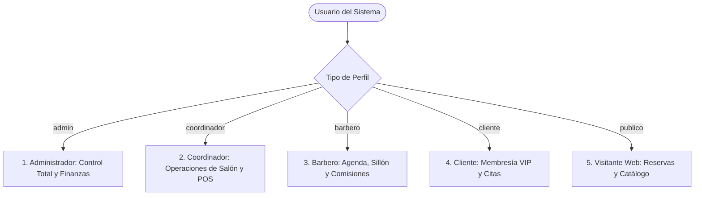
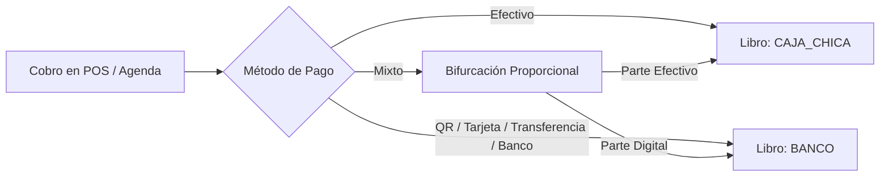
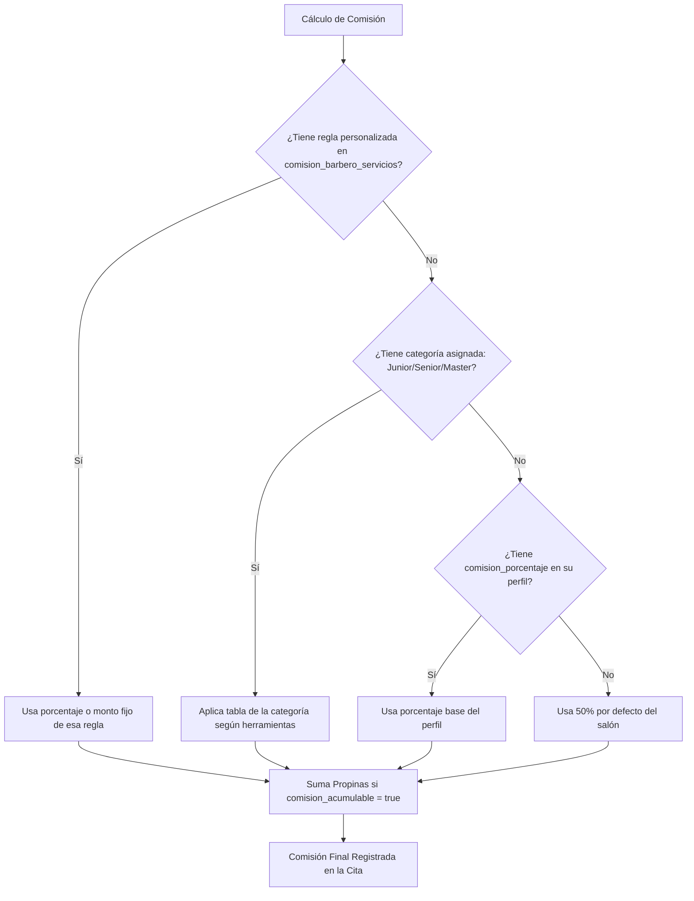

# 💈 Barber Pro Web (BarberSite) — Manual Técnico y Funcional Exhaustivo

Documento maestro de arquitectura, funcionalidades, operaciones por tipo de usuario, diseño contable y reglas de negocio del sistema **Barber Pro Web**.

---

## 1. 🏗️ Arquitectura y Stack Tecnológico

El sistema fue concebido como una plataforma web moderna, rápida y de alta disponibilidad para la gestión integral de barberías premium y cadenas de salones de belleza.

| Capa | Tecnología / Herramienta | Función Principal |
| :--- | :--- | :--- |
| **Frontend Framework** | **Next.js 16 (App Router con Turbopack)** | Renderizado híbrido (SSR + Client Components), rutas optimizadas y compilación ultrarrápida. |
| **Lenguaje** | **TypeScript 5** | Tipado estricto en clientes, APIs, modelos contables y respuestas del servidor. |
| **Estilos y UI** | **Vanilla CSS + Tailwind CSS + Lucide Icons** | Diseño visual *Dark Theme* de alta gama, micro-animaciones, glassmorphism y paleta dorada/ambar (`amber-500`). |
| **PWA (Progressive Web App)** | **Service Worker + Web App Manifest** | Instalable en dispositivos móviles (Android/iOS) y terminales táctiles de recepción. |
| **Base de Datos** | **Supabase (PostgreSQL 15)** | Motor relacional transaccional, Row Level Security (RLS) y disparadores. |
| **Autenticación** | **Supabase Auth (JWT + Cookies)** | Sesiones seguras, recuperación de cuentas, roles (`admin`, `coordinador`, `barbero`, `cliente`). |
| **Tiempo Real (Realtime)** | **Supabase Realtime (WebSockets / CDC)** | Actualización instantánea en agendas, turnos de barberos y notificaciones sin recargar página. |
| **Gráficos e Indicadores** | **Recharts** | Visualización interactiva de ingresos, comisiones, productividad y evolución semanal. |
| **Almacenamiento Multimedia** | **Supabase Storage + Catbox.moe** | Almacenamiento redundante y seguro para imágenes de servicios, productos, avatares y QRs. |
| **Zona Horaria Oficial** | **Bolivia (`America/La_Paz`, UTC-4)** | Todas las fechas, cierres diarios, turnos y arqueos operan en hora boliviana estricta. |
| **Despliegue / Hosting** | **Vercel** | CI/CD automático conectado a la rama `main` en GitHub. |

---

## 2. 👥 Matriz de Roles y Operaciones Detalladas por Usuario

El sistema cuenta con un control de acceso basado en roles (**RBAC**). A continuación se desglosan con total profundidad todas las acciones, permisos y pantallas a las que tiene acceso cada tipo de usuario:

---

### 2.1. 👑 Administrador General (`admin`)
El Administrador tiene control absoluto sobre el negocio, la contabilidad, la configuración del personal, las reglas laborales y las auditorías.

#### 📊 Dashboard Ejecutivo (`/admin`)
- **KPIs en Tiempo Real:** Visualización de ingresos totales del día, citas completadas, promedio de ticket por cliente y comisiones generadas.
- **Gráficos Interactivos:** Evolución semanal de ventas por servicio vs. productos con Recharts.
- **Top de Productividad:** Ranking de barberos que más ingresos y servicios han generado en el mes.
- **Estado de Resultados Resumido (P&L):** Ingresos brutos menos egresos operativos y comisiones, mostrando el margen de ganancia neta.

#### 👥 Gestión de Equipo y Barberos (`/admin/equipo`)
- **Alta y Edición de Personal:** Registro de barberos con nombre completo, correo, teléfono, avatar profesional y foto de su código QR personal para recibir propinas o comisiones.
- **Asignación de Comisiones:** Definición del porcentaje base (ej. 45%, 50%, 60%) o asignación de categoría salarial (Junior, Senior, Master).
- **Herramientas de Trabajo:** Marcación de si el barbero aporta sus propias herramientas (`tiene_herramientas`), lo que ajusta automáticamente su porcentaje de ganancia.
- **Estado de Actividad:** Activar o suspender temporalmente el perfil de un barbero sin borrar su historial financiero.

#### ⏰ Horarios Laborales y Turnos (`/admin/horarios`)
- **Matriz Semanal de Trabajo:** Configuración día por día (Lunes a Domingo) de la hora de entrada y hora de salida de cada barbero.
- **Turnos Fraccionados (Turnos Partidos):** Configuración de recesos intermedios (ej. turno mañana 09:00-13:00 y turno tarde 16:00-20:00), protegiendo el horario intermedio contra citas online.
- **Días Libres y Descansos:** Asignación de días no laborables para cada miembro del equipo.

#### ⚖️ Reglas Laborales y Sanciones (`/admin/reglas-laborales`)
- **Tolerancia de Retraso:** Definición de minutos de gracia (ej. 10 minutos) antes de considerar retraso matutino.
- **Multas por Retraso:** Configuración del cobro por minuto tarde o monto fijo escalonado.
- **Sanciones por Falta Injustificada:** Monto en Bs que se descuenta automáticamente si el barbero no asiste en los 30 minutos posteriores a su hora de inicio.

#### ✂️ Catálogo de Servicios (`/admin/servicios`)
- **Creación de Servicios:** Alta de cortes, diseños, perfilado de cejas, afeitados tradicionales y mascarillas faciales.
- **Parámetros Operativos:** Definición de precio al público (Bs), tiempo estimado de duración (15, 30, 45, 60 min), y descripción comercial.
- **Galería Multimedia:** Carga de fotos de referencia y muestras de trabajos anteriores que se verán en la landing page.
- **Reglas de Exclusión:** Habilitar qué barberos están autorizados a realizar cada servicio específico.

#### 📦 Inventario, Productos y Consignaciones (`/admin/productos`, `/admin/consignaciones`, `/admin/inventario-fisico`)
- **Catálogo Retail:** Registro de productos con precio de venta al público, costo de adquisición, stock actual y umbral de alerta de stock bajo.
- **Gestión de Consignaciones:** Registro de marcas y distribuidores externos que dejan productos a comisión; seguimiento de productos vendidos sin pagar y corte automático de cuentas por pagar los sábados a medianoche.
- **Toma Física de Inventario:** Auditoría manual periódica para contrastar stock en estantería contra stock en sistema, registrando mermas o ajustes.

#### 💸 Motor y Auditoría de Comisiones (`/admin/comisiones`)
- **Reglas Específicas por Servicio:** Posibilidad de sobreescribir la comisión estándar (ejemplo: corte regular 50%, pero en tratamientos faciales de alto costo dar 40% o monto fijo de 25 Bs).
- **Historial de Liquidaciones:** Consulta de pagos emitidos a barberos con desglose de servicios prestados, multas descontadas y adelantos amortizados.

#### 💰 Contabilidad, Cajas y Reportes (`/admin/caja`, `/admin/egresos`, `/admin/reportes`)
- **Monitoreo de Arqueos:** Supervisión de los cierres diarios de caja chica y banco enviados por los coordinadores.
- **Catálogo de Cuentas (`plan_cuentas`):** Administración del plan contable estandarizado.
- **Aprobación de Egresos:** Control de gastos de suministros, alquileres, pagos de luz, agua e internet.
- **Exportación:** Descarga de reportes contables en Excel y PDF para fines impositivos y de balance.

#### 📚 Inducción y Capacitación (`/admin/induccion`)
- Creación de cursos interactivos para nuevos barberos con módulos, videos explicativos y cuestionarios de validación de conocimientos.

#### 🛡️ Auditoría y Usuarios (`/admin/auditoria`, `/admin/usuarios`)
- Log inmutable de cambios: quién editó una cita, quién modificó un precio o quién eliminó un registro.
- Asignación y revocación de credenciales y roles de acceso.

---

### 2.2. 💼 Coordinador de Salón (`coordinador`)
El Coordinador es el administrador de piso responsable de que la barbería opere con fluidez, la caja cuadre perfectamente y los barberos atiendan en orden.

#### 💵 Terminal Punto de Venta — Caja POS (`/coordinador/caja`)
- **Cobro Rápido de Citas:** Búsqueda de la cita del cliente, confirmación del barbero que atendió y cobro con emisión de recibo digital.
- **Venta Cruzada de Productos:** Posibilidad de agregar ceras, pomadas o champús al ticket del cliente en el mismo momento del cobro.
- **Métodos de Pago Múltiples:**
  - *Efectivo:* Entra al libro `CAJA_CHICA` y calcula el cambio/vuelto.
  - *QR / Transferencia Bancaria:* Entra al libro `BANCO` y permite adjuntar referencia o comprobante.
  - *Tarjeta / POS Físico:* Entra al libro `BANCO`.
  - *Pago Mixto:* Desglosa exactamente cuánto se cobró en billetes y cuánto por código QR sin mezclar los libros contables.
- **Deduplicación de Anticipos:** Si el cliente ya pagó el 50% de reserva online, la caja muestra automáticamente solo el saldo restante pendiente de pago.
- **Registro de Propinas:** Campo dedicado para registrar propinas entregadas al barbero (en efectivo o QR).

#### 🔒 Apertura, Cuadre y Arqueo Diario (`/coordinador/arqueo`)
- **Apertura de Caja:** Conteo del fondo inicial de efectivo al iniciar la mañana.
- **Cierre de Turno:** Al finalizar el día, el sistema presenta el total esperado según el sistema vs el conteo físico de billetes y monedas.
- **Detección de Descuadres:** Alerta automática en caso de sobrante o faltante de dinero con justificación obligatoria.
- **Transferencia de Custodia (`EGR-CIE`):** Registro del dinero que se retira de caja para depósito en cuenta bancaria de la empresa o entrega al dueño.

#### 📖 Gestión de Libros Contables (`/coordinador/caja-chica`, `/coordinador/banco`)
- **Libro Caja Chica:** Flujo exclusivo de efectivo en mano dentro del salón (ingresos por cortes, salidas para compras urgentes de hielo, café o insumos).
- **Libro Banco:** Flujo de dinero en la cuenta corriente de la barbería (ingresos por QR, transferencias de anticipos y cobros con tarjeta).

#### ⏱️ Cola Dinámica de Barberos (Orden de Llegada en Vivo)
- **Gestión de la Fila:** Supervisión de la cola matutina según la hora exacta en la que cada barbero marcó asistencia.
- **Asignación de Clientes Espontáneos:** El barbero en primera posición recibe al siguiente cliente sin cita; tras terminar, rota automáticamente al final de la cola.

#### 💸 Liquidación y Pagos a Barberos (`/coordinador/comisiones`, `/coordinador/bonos`, `/coordinador/sanciones`)
- **Adelantos de Sueldo:** Registro de anticipos de dinero concedidos a un barbero con descuento en la cuenta `ACT-001`.
- **Bonos de Productividad:** Asignación de gratificaciones por cumplimiento de metas (`EGR-BONO`).
- **Liquidación Neta:** Emisión del pago semanal calculando:  
  $$\text{Pago Final} = \text{Comisiones Ganadas} + \text{Propinas} + \text{Bonos} - \text{Adelantos} - \text{Multas}$$

#### 🎂 Cumpleaños y Clientes (`/coordinador/cumpleanos`, `/coordinador/referidos`)
- Monitoreo de clientes que cumplen años en el día para aplicar promociones de fidelidad.
- Aplicación de saldo de referidos en caja cuando un cliente presenta su código de descuento.

---

### 2.3. ✂️ Barbero / Profesional (`barbero`)
El Barbero dispone de un panel optimizado para dispositivos móviles y tablets colocado junto a su sillón de trabajo.

#### 📱 Reloj Biométrico y Asistencia (`AsistenciaWidget`)
- **Marcación de Entrada:** Botón de un toque para registrar inicio de labores matutino.
- **Control de Refrigerio:** Registro de salida y retorno del almuerzo o descanso.
- **Marcación de Salida:** Cierre formal de su jornada de trabajo.
- **Consulta de Asistencia:** Historial de retrasos del mes, faltas y justificaciones.

#### 📅 Agenda Individual en Tiempo Real (`/barbero` y `/agenda/[id]`)
- **Vista de Citas del Día:** Horas reservadas, nombre del cliente, servicio a realizar y notas especiales (ej. "Corte degrafilado bajo con diseño").
- **Cambio de Estado:** Marcación de cita como "En Proceso" al subir al cliente al sillón y "Finalizado" al concluir.
- **Filtros Ágiles:** Visualización por día, semana o mes, y filtrado por citas pendientes, confirmadas o completadas.

#### ⚡ Venta Rápida en Sillón (Walk-in)
- Para clientes que ingresan sin reserva previa, el barbero puede abrir la modal de **Venta Rápida** desde su propio teléfono.
- Selecciona el servicio realizado, añade productos vendidos de su estante y registra el cobro de inmediato.

#### 🛒 Mini POS de Productos (`/barbero/pos`)
- Venta directa de ceras fijadoras, lociones o tónicos a su cliente durante el servicio para sumar comisión de venta de productos.

#### 📈 Tablero Financiero Personal
- **Ganancias en Vivo:** Total acumulado en Bs que lleva ganado en el día y en la semana por concepto de comisiones.
- **Propinas Acumuladas:** Monitoreo transparente de propinas que la recepción o el cliente le han dejado.
- **Saldo de Deudas y Premios:** Visualización de adelantos pendientes de amortizar y bonos ganados pendientes de cobro.
- **Meta Mensual:** Barra de progreso hacia su objetivo de cortes del mes frente al promedio del salón.

#### 📄 Solicitud de Permisos (`BarberoPermisosWidget`)
- Envío digital de solicitudes de permiso por salud, motivos personales o vacaciones con fecha, hora y motivo.
- Generación y descarga automática del comprobante de permiso en **formato PDF** listo para imprimir o firmar.

#### 🎓 Aula Virtual de Capacitación (`/barbero/induccion`)
- Acceso a lecciones de protocolo de atención al cliente, técnicas avanzadas de barbería y normas de bioseguridad del salón.

---

### 2.4. 🌟 Cliente Registrado (`cliente`)
El cliente disfruta de una experiencia digital exclusiva estilo club privado que premia su preferencia.

#### 💳 Tarjeta VIP de Fidelidad Digital
- **Membresía Interactiva:** Tarjeta virtual con diseño personalizado y animaciones según su categoría:
  - 🥉 **Bronce:** Cliente inicial.
  - 🥈 **Plata:** Desde 15 visitas.
  - 🥇 **Oro:** Desde 30 visitas.
  - 💎 **Platino:** Desde 45 visitas.
  - 👑 **Diamante:** Nivel supremo para clientes VIP (más de 60 visitas).
- **Medidor de Fidelidad:** Conteo visible de visitas históricas y dinero invertido en su imagen personal.

#### 🎟️ Pase Digital de Cita (Boarding Pass con QR)
- Cada cita confirmada genera un **Pase Digital** interactivo con código QR único.
- Al llegar al local, el cliente simplemente muestra su pantalla en recepción para que el coordinador valide su llegada al instante.
- Muestra el barbero asignado, la fecha, hora exacta, tiempo de servicio y saldo pendiente.

#### 🔄 Gestión y Reprogramación de Citas
- **Consulta de Citas Activas:** Ver la cuenta regresiva para su próximo corte.
- **Solicitud de Reprogramación:** Si le surge un imprevisto, puede solicitar cambio de fecha y hora directamente desde el panel sin tener que llamar por teléfono.
- **Cancelación Oportuna:** Opción de cancelar la reserva respetando las políticas de cancelación del negocio.
- **Subida de Comprobante:** Si no pagó el anticipo al momento de reservar, puede subir la captura de la transferencia bancaria más tarde en su panel.

#### ⭐ Calificaciones y Reseñas
- Al finalizar un servicio, el cliente puede puntuar a su barbero con estrellas (1 a 5) y dejar un comentario sobre su experiencia, ayudando a reconocer a los mejores profesionales.

#### 🎂 Programa de Cumpleaños
- Registro de fecha de nacimiento con subida de fotografía de documento de identidad para verificación.
- Alarma de cumpleaños que otorga promociones exclusivas (ej. corte gratis o 50% de descuento en el mes de su aniversario).

#### 🎁 Canje de Metas y Premios
- Barra interactiva de sellos digitales: *"Te faltan 2 visitas para tu Arreglo de Barba de Cortesía"*.
- Historial de cupones y premios ya canjeados en el salón.

#### 🤝 Programa Viral de Referidos (Gana Saldo)
- Cada socio cuenta con un código único (ej. `CARLOS-921`).
- Botón de compartir en WhatsApp para invitar a amigos.
- Cada vez que un amigo recomendado se realiza su primer corte, el cliente acumula saldo a favor aplicable como descuento en sus siguientes visitas.

---

### 2.5. 🌐 Visitante Web / Público General (Sin Cuenta Requerida)
Cualquier persona que entre a la web desde su celular o computadora tiene acceso a:

#### 🖥️ Portal Web Interactivo (`/`)
- Banner Hero con estilo clásico-moderno y llamado a la acción inmediato.
- Menú visual interactivo de servicios con precios transparentes y tiempos de ejecución.
- Directorio de barberos con sus fotos de perfil y portafolio de estilos.
- Ubicación física del local con mapa interactivo, horarios de apertura y botón de contacto directo a WhatsApp.

#### 📅 Sistema de Reserva Online en 5 Pasos (`/reservar`)
1. **Paso 1 — Selección de Servicio:** Selección de cortes, barbas o combos estéticos.
2. **Paso 2 — Selección de Barbero:** Opción de elegir a su barbero de confianza o marcar *"Cualquiera disponible"* para máxima rapidez.
3. **Paso 3 — Horario Inteligente:** El generador de slots muestra exclusivamente horarios reales disponibles, respetando citas existentes, turnos partidos y recesos.
4. **Paso 4 — Datos del Cliente:** Formulario rápido con nombre, teléfono, correo y casilla para ingresar código de referido de un amigo.
5. **Paso 5 — Anticipo y Pago QR:** Muestra el código QR oficial del salón para abonar el 50% de reserva con subida inmediata del comprobante de pago. Genera un ID de cita rastreable.

#### 🛍️ Tienda Online (`/tienda`)
- Catálogo de productos profesionales con selector de unidades, descripción y precios.
- Carrito de compras para retiro en sucursal (Pickup).

---

## 3. 💰 Motor Financiero y Contabilidad de Partida Doble

Uno de los pilares del sistema es la integridad financiera auditada. Opera bajo el estándar de dos libros independientes:

### Plan de Cuentas Contable Estandarizado (`plan_cuentas`)

| Código de Cuenta | Nombre Contable | Tipo | Descripción de Flujo |
| :--- | :--- | :--- | :--- |
| `4.1.2` | **Ingresos por Servicios** | Ingreso | Cobro de cortes, barbas, combos y servicios de estética. |
| `4.1.1` | **Ingresos por Productos** | Ingreso | Venta retail de ceras, pomadas, champús y tónicos. |
| `4.1.3` | **Ingresos Varios** | Ingreso | Ajustes a favor, alquiler de espacios u otros ingresos no operativos. |
| `ING-SANCION` | **Ingreso por Sanción / Falta** | Ingreso | Descuentos de multas aplicadas al personal que ingresan a la empresa. |
| `EGR-COM` | **Pago de Comisiones Barberos** | Egreso | Liquidación de haberes y comisiones ganadas por el equipo. |
| `EGR-BONO` | **Bonos e Incentivos al Personal** | Egreso | Premios por meta alcanzada o incentivos de rendimiento. |
| `ACT-001` | **Adelantos a Personal** | Activo/Egreso | Anticipos de sueldo concedidos a los barberos. |
| `EGRESO` / `EGR-GEN` | **Gastos Operativos Generales** | Egreso | Servicios básicos (luz, agua, internet), insumos de limpieza, compras menores. |
| `EGR-CIE` | **Transferencia de Cierre / Arqueo** | Egreso/Control | Movimientos de retiro o traspaso de custodia al cerrar jornada. |

### Reglas Clave Implementadas
1. **Deduplicación de Anticipos QR:** Si un cliente reservó por la web y pagó el 50% de anticipo por QR, ese dinero ya ingresó al libro `BANCO`. Al finalizar la cita en recepción, el sistema únicamente registra el cobro del saldo restante para **no inflar ni duplicar los ingresos bancarios**.
2. **Pago Mixto Exacto:** Si un cliente paga un servicio de 60 Bs con 30 Bs en efectivo y 30 Bs por QR, el sistema desglosa exactamente `monto_efectivo = 30` en `CAJA_CHICA` y `monto_qr = 30` en `BANCO`.
3. **Consistencia de Saldos Históricos:** Se respeta la conciliación contable base al 29/07/2026 (Caja Chica: Bs. 64.50; Banco: Bs. 1,088.29).

---

## 4. ✂️ Motor de Comisiones de Barberos

El sistema calcula la comisión neta de cada profesional de forma granular a través de `src/lib/comisiones/calcular.ts`:

- **Herramientas Propias vs del Salón:** Si el barbero aporta sus propias máquinas (`tiene_herramientas = true`), su porcentaje de comisión puede incrementarse (ej. 55% vs 45%).
- **Comisiones Mixtas:** Soporta modalidades por **porcentaje (%)** o por **monto fijo en Bs** por servicio.
- **Propinas:** Las propinas se acumulan íntegramente a favor del barbero sin retención.
- **Descuento de Deudas en Pago:** Al emitir la orden de pago de comisiones en `/coordinador/comisiones`, el sistema descuenta automáticamente multas pendientes (`ING-SANCION`) y adelantos recibidos (`ACT-001`).

---

## 5. 📅 Agenda Inteligente y Reservas Manuales

### Generador de Slots Inteligentes (`src/lib/booking/booking-slots.ts`)
1. **Paso Flexible de 15 Minutos:** Genera horarios cada 15 min dentro del horario operativo (ej: 09:00, 09:15, 09:30).
2. **Horarios Continuos Inmediatos (`⚡ Continuo`):** Detecta cuando una cita previa termina en una hora impar (ej. 10:35 o 11:20) e inserta automáticamente ese minuto exacto como slot disponible para optimizar el tiempo muerto en los sillones.
3. **Soporte de Turnos Fraccionados (Turnos Partidos):** Si un barbero atiende en doble turno (ej. Mañana: 09:00 a 12:30 y Tarde: 17:00 a 21:00), el intervalo intermedio queda protegido contra reservas.
4. **Modo Reloj Libre (Hora Exacta):** En la modal de cita manual, el coordinador puede seleccionar o ajustar con botones de `+5m`, `+15m`, `-5m` la hora exacta de atención sin bloqueos automáticos.
5. **Modo Manual Bypassing:** Para reservas manuales de recepción o caja, el sistema no bloquea la cita si el barbero aún no marcó entrada biométrica ese día.

---

## 6. 🕒 Control de Asistencia y Cola de Barberos

### 1. Marcación de Jornada (`AsistenciaWidget.tsx`)
- Marcación de **Entrada**, inicio/fin de **Refrigerio/Almuerzo** y **Salida**.
- Detección de retrasos respecto al horario oficial con cálculo automático de minutos tarde.
- Cierre automático nocturno mediante cron job para turnos que olvidaron marcar salida.

### 2. Cola de Turnos en Vivo (`OrdenLlegadaBarberos.tsx`)
- Algoritmo que premia el orden de llegada en la mañana.
- El barbero que llegó primero pasa a ser el **Siguiente en Turno (👉)**.
- Cuando atiende un servicio, rota automáticamente al final de la cola para garantizar que el trabajo se distribuya equitativamente entre todos los barberos del turno.

### 3. Faltas y Permisos
- Cron job diario (`/api/cron/asistencias/faltas`) que evalúa quién no se presentó 30 minutos después de su hora pactada y genera la sanción económica configurada en el sistema.
- Módulo de permisos con generación de solicitud y PDF firmado para RRHH.

---

## 7. 🎁 Lealtad, Promociones y Referidos

### 1. Motor Promocional 2×1
- Algoritmo de promociones (`calcularDescuentoYPrecio2x1`) que en días de promoción 2×1 descuenta exactamente la mitad del corte o barba, protegiendo el precio de los productos o combos añadidos.

### 2. Tarjeta de Lealtad Digital (`/cliente`)
- Contabilizador de visitas confirmadas del cliente.
- Metas dinámicas (ej. Al llegar a 5 visitas: *Arreglo de Barba Gratis*; a las 10 visitas: *Corte Clásico de Cortesía*).
- Canje automatizado en el Punto de Venta (Caja POS).

### 3. Programa Viral de Referidos
- Cada cliente registrado posee un código único (ej. `KEVIN-771`).
- Cuando un cliente nuevo introduce el código de un amigo en su primer servicio, el recomendante acumula saldo a favor aplicable en su próxima visita.

---

## 8. 📦 Inventario, Consignaciones y Pedidos

- **Control de Stock en Tiempo Real:** Validación preventiva en caja POS para evitar inventario negativo (`Math.max(0, stock - cantidad)`).
- **Kardex de Movimientos:** Cada venta en POS o ajuste manual queda registrado en `inventario_movimientos`.
- **Consignaciones de Proveedores:** Seguimiento de productos entregados a comisión por marcas externas con corte automático los sábados a medianoche para liquidación de cuentas por pagar.

---

## 9. 🛡️ Resumen de Correcciones y Mejoras Recientes

Durante la auditoría integral se sanearon y optimizaron **36 archivos**:

1. **Corrección de Columnas:** Sustitución de la columna inexistente `citas.total` por `citas.precio` en los dashboards administrativo y coordinador.
2. **Homologación de Zona Horaria (-04:00):** Se eliminó el desfase UTC que provocaba que citas cobradas a las 20:30 se computaran erróneamente en el día siguiente.
3. **Soporte Digital Completo:** Se unificó el criterio en Egresos, Caja Chica y Banco para que pagos por `transferencia`, `tarjeta` y `banco` se registren de inmediato en `monto_qr` y afecten al libro `BANCO`.
4. **Saneamiento del Plan de Cuentas:** Se crearon las cuentas faltantes (`ING-001`, `EGR-CIE`, `ING-SANCION`, `ACT-001`, `EGR-COM`, `EGR-BONO`, `EGRESO`, `4.1.2`, `4.1.1`) evitando errores de clave foránea (FK 23503).
5. **Reclasificación de Bonos:** Los bonos al personal se corrigieron de la cuenta de ingresos `4.1.3` a la cuenta de egresos `EGR-BONO`.
6. **Optimización de Disponibilidad:** Se desacopló la reactividad en `ModalCrearCitaManual` y se habilitó `&manual=true` para agendar citas sin interferencia de la marcación biométrica matutina.
7. **Eliminación de Filtro Erróneo en Reservas:** Se retiró el filtro que ocultaba barberos si solo tenían comisiones configuradas para ciertos servicios.
8. **Seguridad en Almacenamiento Multimedia:** Sustitución de la dependencia de ImgBB por subida redundante prioritaria a Supabase Storage y Catbox.moe para evitar imágenes no disponibles.

---

*Manual maestro generado como respaldo oficial de arquitectura, roles y operaciones del proyecto BarberSite.*
